<p align="center"></p>

# EA Health Monitor (MetaTrader 5 and MetaTrader 4)

A free indicator that shows **one table row per Expert Advisor** on the account, found by magic number, plus a row for manual
trades and a total: closed trades, net result, win rate, profit factor, max drawdown of the realized result, today's result,
open positions and their floating P/L. It reads the account history and the open positions only; it never trades. Source for both
editions, a Python reference of the statistics, and the tests that were used to check that MT5, MT4 and Python agree.

**Website:** [allanninal.dev/mql5 (utilities)](https://www.allanninal.dev/mql5/#utilities) · [MT4 editions](https://www.allanninal.dev/mql5/#mt4) · [allanninal.dev](https://www.allanninal.dev)
· **Contact:** message me on [LinkedIn](https://www.linkedin.com/in/allanninal/).

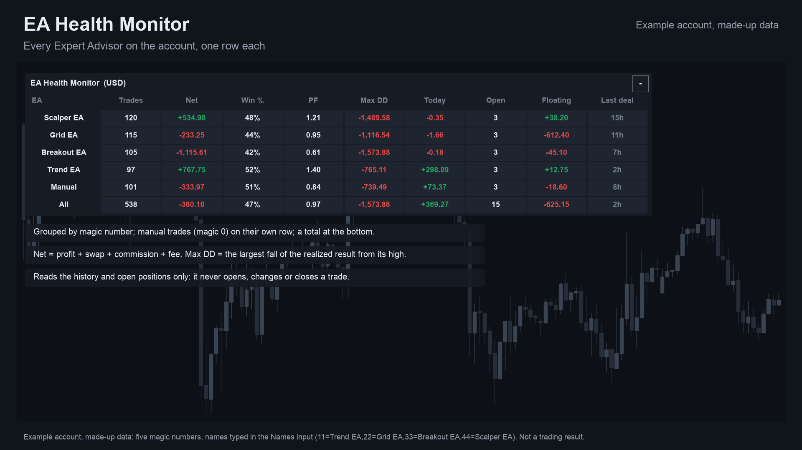

> It reports what the account did. It does not judge whether an EA will work. Nothing here is a profit claim
> (see [Honest limits](#honest-limits)).

## Get it on the MQL5 Market

| Edition | Platform | Price | Link |
|---|---|---|---|
| EA Health Monitor | MT5 | free | <https://www.mql5.com/en/market/product/201797> |
| EA Health Monitor MT4 | MT4 | free | <https://www.mql5.com/en/market/product/202428> |
| EA Health Monitor Pro | MT5 | paid | <https://www.mql5.com/en/market/product/201799> |
| EA Health Monitor Pro MT4 | MT4 | paid | <https://www.mql5.com/en/market/product/202431> |

The Market builds are the same calculation as the source in this repository. The Pro editions are a separate, paid product that
is **not** part of this repository (see [Free vs Pro](#free-vs-pro)).

## Contents

1. [What it is and who it is for](#what-it-is-and-who-it-is-for)
2. [Why it was built](#why-it-was-built)
3. [How it works](#how-it-works)
4. [How it was tested](#how-it-was-tested)
5. [Architecture](#architecture)
6. [Inputs, install and compile](#inputs-install-and-compile)
7. [Run the Python reference and the tests](#run-the-python-reference-and-the-tests)
8. [Honest limits](#honest-limits)
9. [Free vs Pro](#free-vs-pro)
10. [Licence](#licence)

## What it is and who it is for

**What:** a panel of chart objects, refreshed every two seconds. Each row is one magic number (one Expert Advisor), in the order
each first traded; magic 0 is "Manual"; the last row, "All", adds them up. Columns: Trades, Net, Win %, PF, Max DD, Today, Open,
Floating, Last deal. Hover a cell for gross profit, gross loss, wins, losses and expectancy per trade. A manual close of an EA's
trade stays with that EA.

**For:** traders who run several Expert Advisors on one account and want to see which one is doing what, not just one combined
statement. Also for developers: the statistics are a small, tested core you can read.

**Not for:** judging an EA from a few trades, or anyone who wants alarms, period filters or curves (those are in the paid Pro).

| | |
|---|---|
| 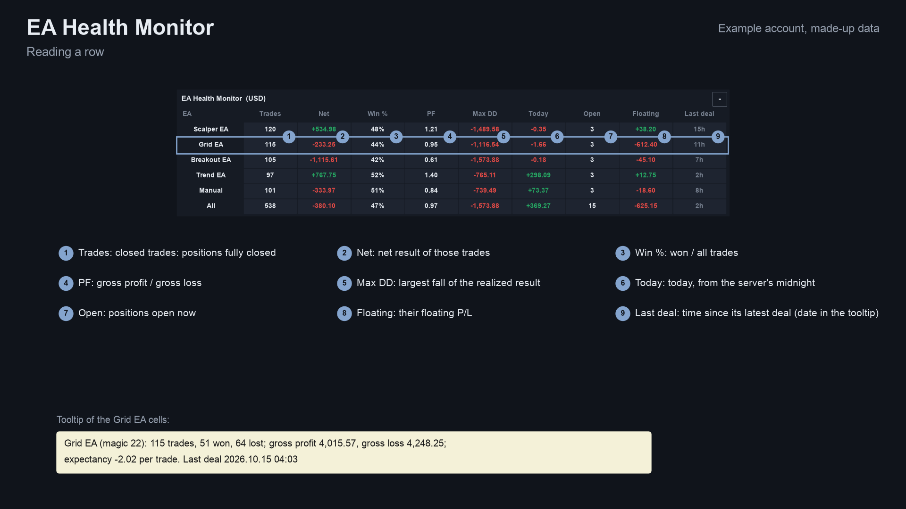 | 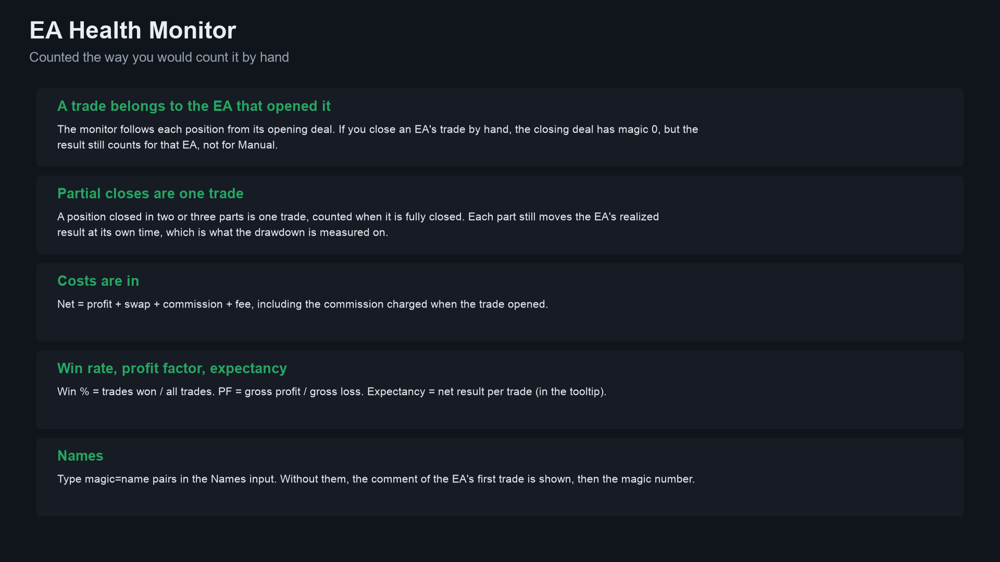 |

Image notes: the screenshots use an example account with made-up data (five magic numbers, names typed in the Names input);
they are illustrations, not terminal captures, and not trading results. MT4 versions are in [`docs/images/mt4/`](docs/images/mt4).

## Why it was built

- **A combined statement hides which EA carries the others.** A per-magic table answers it at a glance.
- **Weak, scattered demand, stated plainly.** Our October 2026 research found a Myfxbook reply listing checks people skip for bots
  (open-basket floating loss, restart during an open trade), a Programming-forum thread on EA portfolio analysis (235 views) and a
  handful of equity and drawdown panels on the Market. That is a small signal, not proof of mass demand.
- **So it is free and its value is that the numbers are checked.** The statistics follow common definitions and are compared with an
  independent Python version on thousands of deals.

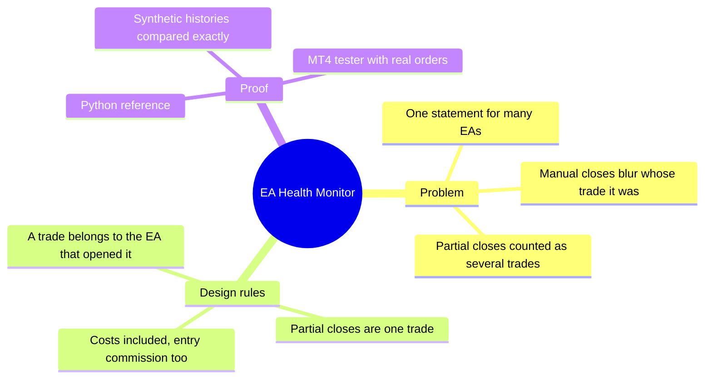

## How it works

### The rules, step by step

For each deal, in time order (MT4: orders turned into deals, see below):

1. **Position and owner.** An opening (IN) deal creates a position owned by the deal's magic number. Every later deal of that
   position (partial closes, the final close, even a manual close with magic 0) belongs to the same owner. If the opening deal is
   not in the history, the first deal seen gives the owner.
2. **Realized curve.** Each deal adds `profit + swap + commission + fee` to its owner's curve at its time (the commission charged at
   opening included).
3. **Max drawdown.** `peak = max(peak, curve)`, `maxDD = max(maxDD, peak - curve)`; the peak starts at 0.
4. **A trade** is a position whose closed volume has reached its opened volume. Its net is the sum over all its deals. A reversing
   deal (IN/OUT) closes the trade and opens the next one with the volume beyond.
5. **Statistics per owner.** Trades `N`; wins `W` (net > 0) and losses `L` (net < 0); gross profit `GP` and gross loss `GL`;
   - win rate `= W / N`
   - profit factor `= GP / GL` (shown as "no loss" when `GL = 0` and `GP > 0`)
   - expectancy `= (GP - GL) / N`.
6. **Today** is the owner's realized result since server midnight. **Open** and **Floating** come from the open positions (floating
   = profit + swap; MT4 adds commission, which MT4 books at the close).
7. **Names.** The Names input (`magic=name,...`), else the comment of the EA's first opening deal plus the magic, else `#magic`.

**MT4** keeps orders, not deals. Each order becomes an opening deal (open time, lots) and, once closed, a closing deal (close time,
lots, profit, swap, commission). A partial close leaves the rest open under a new ticket whose comment is `from #<ticket>`; all
parts are one position. The book is rebuilt whenever the orders change.

### Per-deal algorithm

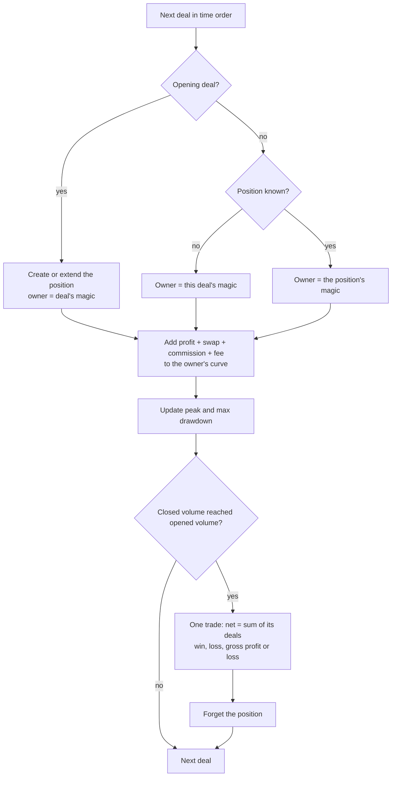

### A position's life

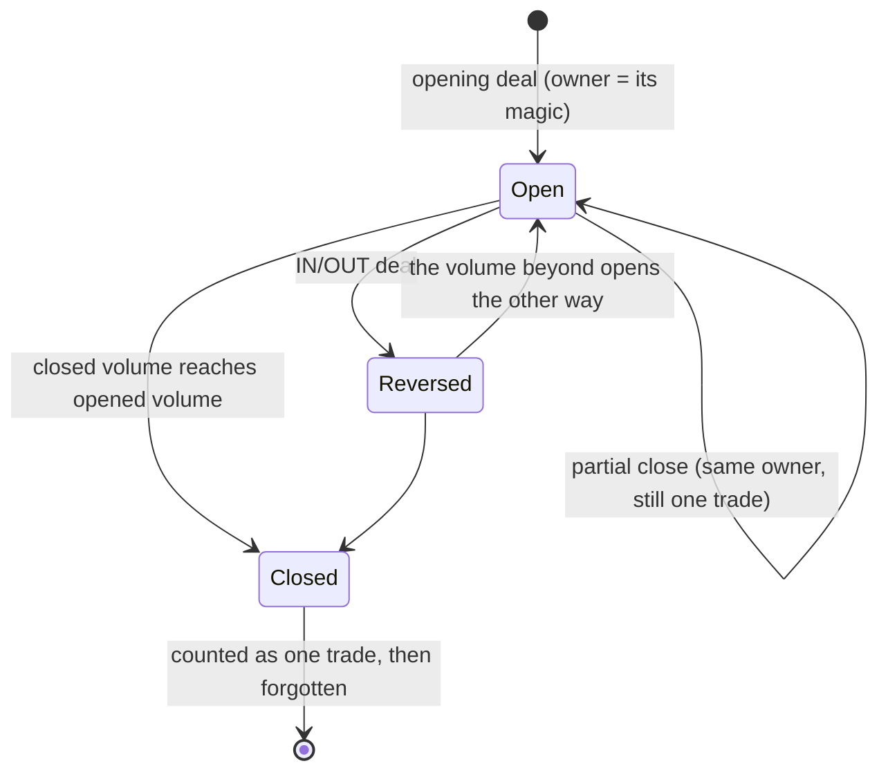

### Refresh flow

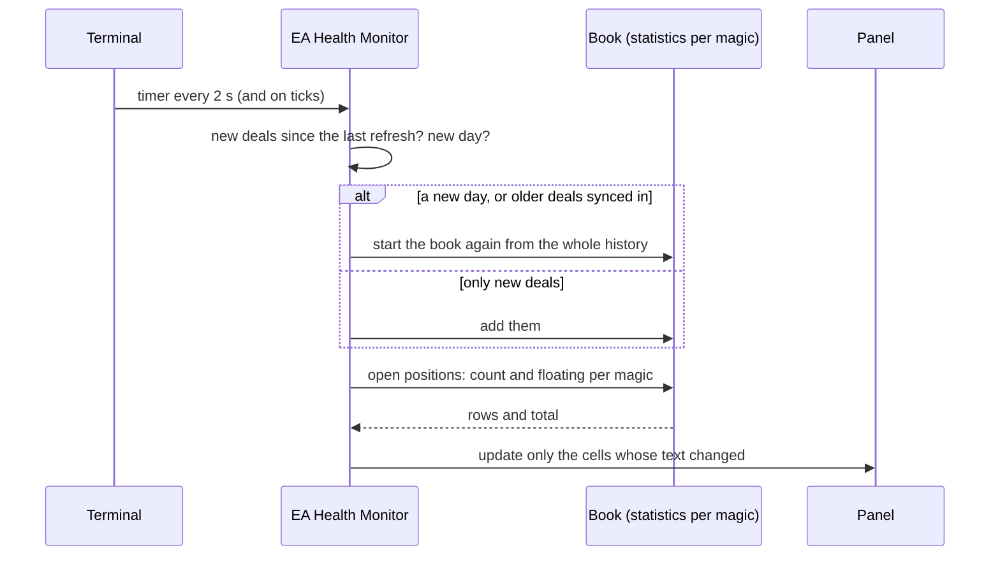

## How it was tested

**1. The core against Python, on synthetic histories.** [`tests/reference.py`](tests/reference.py) follows the rules operation by
operation. [`tests/check_core.py`](tests/check_core.py) writes seeded synthetic deal lists (hedging-style positions with partial
closes, manual closes, reversals, entry commissions, some positions left open). The test script
[`tests/mql5/Scripts/EAHealthDump`](tests/mql5/Scripts) runs them through the MT5 core in the MetaTrader 5 terminal and writes the
statistics, and the checker compares every number (counts exactly, money within 1e-9 relative).

| History | Deals | Magics | Trades | Result |
|---|---|---|---|---|
| seed 1 | 900 | 5 | 346 | pass |
| seed 2 (2,000 positions) | 4,496 | 5 | 1,817 | pass |
| seed 3 (manual only) | 905 | 1 | 355 | pass |
| seed 4 (50 positions) | 117 | 5 | 46 | pass |
| seed 5 (two EAs) | 1,799 | 2 | 708 | pass |
| seed 6 (30 magics) | 6,839 | 30 | 2,732 | pass |
| **Total** | **15,056** | | **6,004** | **ALL PASS** |

Source: [`tests/results/core-parity-mt5.txt`](tests/results/core-parity-mt5.txt).

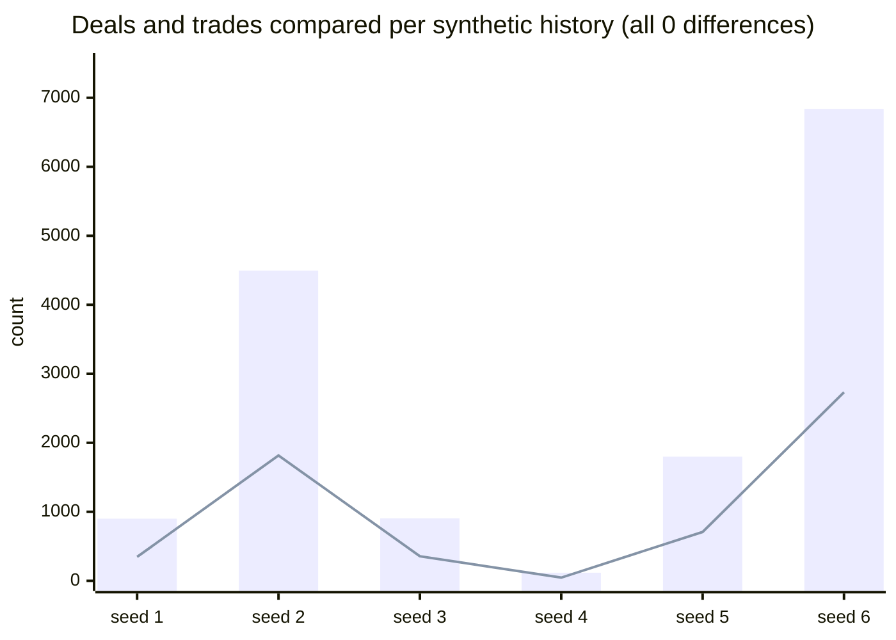

Bars: deals. Line: trades.

**2. The MT4 edition in the MetaTrader 4 Strategy Tester.** [`tests/mt4/HealthTrader.mq4`](tests/mt4/HealthTrader.mq4) trades a seeded
random mix (several magic numbers and manual orders, comments, stop loss and take profit, partial closes, full closes, close-by) and,
every few hundred bars and at the end, writes the raw orders and its own book. [`tests/mt4/check_mt4.py`](tests/mt4/check_mt4.py)
turns the raw orders into deals on its own and compares every statistic, open count, floating and row name with the Python
reference.

| | Result |
|---|---|
| Runs | 9 (2 seeds x 4 symbols + one every-tick run) |
| Snapshots compared | 146 |
| Trade operations made by the test | 25,220 |
| Trades in the final snapshots | 7,972 |
| Result | ALL PASS |

Source: [`tests/results/parity-mt4.txt`](tests/results/parity-mt4.txt).

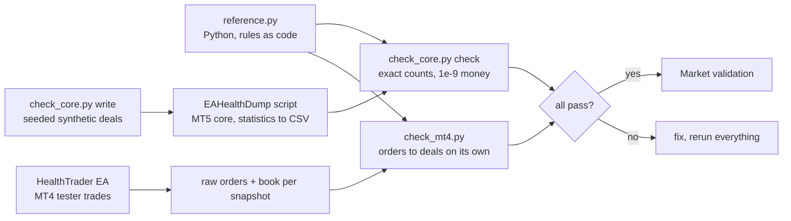

**3. Market validation.** Both Market builds passed the MQL5 Market's automated product validation before publication (the Market's
own check, not part of this repository).

**What the tests do not cover.** The panel text and layout (the MT4 tester gives an indicator run through `iCustom` no chart, so only
the book the panel shows is compared; the indicator is loaded in every run as a smoke test); the live history of a real account
(only synthetic histories and tester trades were compared); the MT4 test account is a cent account, so many orders were refused for
margin and some runs ended early.

## Architecture

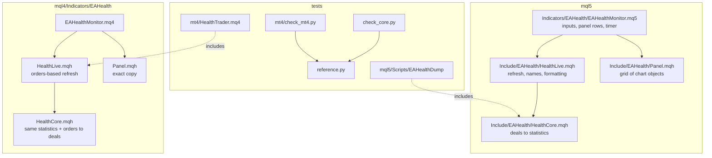

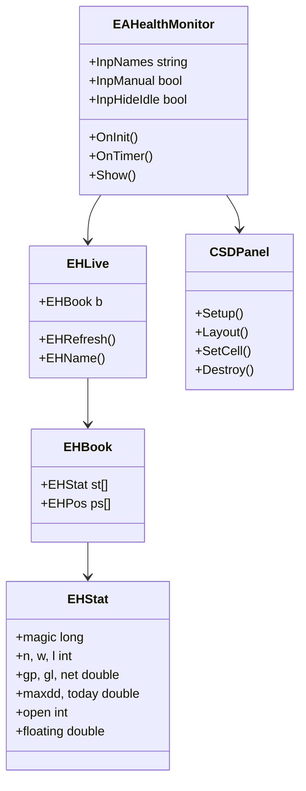

The indicator has no buffers and no `iCustom` interface: it is a panel.

## Inputs, install and compile

| Input | Default | Meaning |
|---|---|---|
| Names: magic=name, comma separated | empty | e.g. `771500=Trend EA,0=Manual` |
| Show manual trades (magic 0) | true | The "Manual" row |
| Hide EAs with nothing to show | false | Hide rows with no trade and nothing open |
| Panel corner, distance from the side and the top, font size | top left, 10, 20, 9 | Position and size |
| Colours: panel, cell, text, header, positive, negative | dark theme | Appearance |

**Install from source.** MT5: copy `mql5/Indicators/EAHealth/` into `<terminal data folder>/MQL5/Indicators/` and
`mql5/Include/EAHealth/` into `<data folder>/MQL5/Include/`, open `EAHealthMonitor.mq5` in MetaEditor and press Compile (F7).
MT4: copy `mql4/Indicators/EAHealth/` (it holds all four files) into `<data folder>/MQL4/Indicators/` and compile
`EAHealthMonitor.mq4`. Both compile with 0 errors and 0 warnings (checked with the MetaEditor of a MetaTrader 5 and a MetaTrader 4
build on a Windows machine; the compiled files are not in the repository).

## Run the Python reference and the tests

```bash
python3 -m venv .venv && . .venv/bin/activate && pip install -r requirements.txt
```

```python
import sys; sys.path.insert(0, "tests")
from reference import compute, synth
deals = synth(seed=1)                  # seeded random history, deals in time order
stats = compute(deals, day_start=0)    # per magic: n, w, l, gp, gl, net, curve, peak, maxdd, today, last, deals
```

To repeat the MT5 core check: `python3 tests/check_core.py write <dir>`, copy `<dir>/deals_*.csv` to the terminal's common
`Files\ehtest\` folder, compile and run `tests/mql5/Scripts/EAHealthDump` (it writes `stats_<n>.csv` there), copy those back to
`<dir>` and run `python3 tests/check_core.py check <dir>`. For MT4: compile `tests/mt4/HealthTrader.mq4`, run it in the Strategy
Tester (open prices) with the inputs in `tests/mt4/configs.tsv`, then `python3 tests/mt4/check_mt4.py <folder with the files>`.

## Honest limits

- **It reports history; it does not predict.** A few trades prove little. No profit or accuracy claim is made.
- **Max drawdown is of the realized result**, from the first deal in the history, not of the account's equity. In the "All" row it is
  the largest of the rows, not the account's drawdown.
- **History must be available.** The panel can only count what the terminal's account history holds; if you cut the history
  range in the terminal, the numbers change.
- **A bug found on the way.** MQL4's `StringSubstr(s, 0, 0)` returns the whole string, so a comment that was only a server-close marker such as `[sl]` was read as a name; fixed in `EHCleanComment` (MT4 core) before the published test run.
- **MT4 books the commission at the close**, so an open trade's floating P/L includes it there; MT5 books it at the entry deal.
- **Scope of the tests.** Synthetic histories and tester trades, not a real account; the panel text is not covered in the MT4 tester.
- Period filters, curves, alarms and reports exist in a separate paid product (see below).

## Free vs Pro

| | Free: EA Health Monitor | Paid: EA Health Monitor Pro |
|---|---|---|
| Platforms | MT5 [201797](https://www.mql5.com/en/market/product/201797), MT4 [202428](https://www.mql5.com/en/market/product/202428) | MT5 [201799](https://www.mql5.com/en/market/product/201799), MT4 [202431](https://www.mql5.com/en/market/product/202431) |
| Price | free | paid (see the Market page) |
| What you get | The per-EA table for all history, source here | More than the table, as described on its Market listing |
| Source | this repository | not published |

No need to buy the paid product to use the free one: the free indicator is complete on its own.
Website: [allanninal.dev/mql5](https://www.allanninal.dev/mql5/#utilities) ([MT4](https://www.allanninal.dev/mql5/#mt4)).

## Licence

Everything is © 2026 Allan Niñal under the
[PolyForm Noncommercial License 1.0.0](LICENSES/PolyForm-Noncommercial-1.0.0.md): source-available, free for personal and other
noncommercial use, not for commercial use. Each source file has an `SPDX-License-Identifier` line; the text is in
[`LICENSE`](LICENSE). The licence applies to this source, not to anything you build or trade with the indicator. Trading involves
risk; the software is provided as is.

---

**Website:** [allanninal.dev/mql5](https://www.allanninal.dev/mql5/#utilities) · [MT4](https://www.allanninal.dev/mql5/#mt4) · [allanninal.dev](https://www.allanninal.dev)
· Questions: message me on [LinkedIn](https://www.linkedin.com/in/allanninal/).
